# Kredensial Mikro Terverifikasi Blockchain — Kode Prototipe Buku

<p align="center">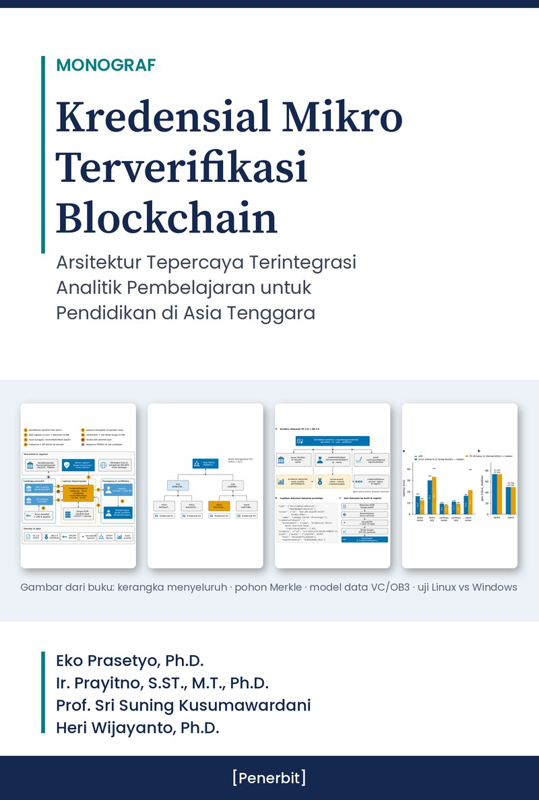</p>

Kode pendamping monograf **_Kredensial Mikro Terverifikasi Blockchain: Arsitektur Tepercaya Terintegrasi Analitik Pembelajaran untuk Pendidikan di Asia Tenggara_**.

**Penulis:**
1. Eko Prasetyo, Ph.D. (Universitas Muhammadiyah Yogyakarta)
2. Assoc. Prof. Ir. Prayitno, S.ST., M.T., Ph.D. (Politeknik Negeri Semarang)
3. Prof. Sri Suning Kusumawardani (Departemen Teknik Elektro dan Teknologi Informasi, FT Universitas Gadjah Mada)
4. Heri Wijayanto, Ph.D. (Jurusan Teknologi Informasi, FT Universitas Mataram)

> **English summary.** This is the companion prototype for the Indonesian monograph *Blockchain-Verified Micro-Credentials*. It is a web information system (FastAPI + web3.py + SQLite + a Solidity `CredentialRegistry` contract on a local Hardhat chain). Institutions issue W3C VC 2.0 / Open Badges 3.0-style micro-credentials, sign them, and anchor their hashes on-chain (single or Merkle batch). Learners keep them in a wallet with a QR code. Verifiers check the hash, issuer signature, issuer status and revocation status. A learning-analytics dashboard trains an early-prediction model on the public OULAD dataset (CC BY 4.0), and its result can be attached as credential `evidence`. The code is for **education and research only**. It runs on a **local test chain** and is **not production software**. Code licence: MIT. The book text is not included.

> ⚠️ **Penafian.** Repositori ini hanya untuk pendidikan dan penelitian. Prototipe berjalan pada **blockchain uji lokal** (Hardhat, chainId 31337) atau eth-tester dalam proses. Prototipe ini **bukan sistem produksi** dan belum diaudit keamanannya. Jangan memakainya di jaringan publik atau mainnet. Penerbit "Universitas Muhammadiyah Yogyakarta (contoh)" dan "ICE Institute (contoh)" pada demo multi-lembaga adalah **skenario hipotetis**, bukan implementasi nyata di lembaga tersebut. Semua data peserta adalah data fiktif (`@contoh.ac.id`).

## Isi repositori

| Folder/berkas | Isi |
|---|---|
| `contracts/CredentialRegistry.sol` | Smart contract Solidity 0.8.24: registri penerbit, `issue`, `issueBatch`, `anchorBatchRoot` (Merkle), `revoke`, `verify`, `verifyInBatch`, penonaktifan penerbit tanpa efek mundur. |
| `backend/` | FastAPI + web3.py + SQLite (`app.py`, `chain.py`, `vc.py`), antarmuka web di `static/`, dan ABI/bytecode hasil kompilasi di `build/CredentialRegistry.json`. |
| `hardhat/` | Konfigurasi node blockchain lokal (tanpa kunci rahasia). `node_modules` tidak disertakan; dipasang otomatis oleh `npm install`. |
| `analytics/` | `train_oulad.py` (pandas + scikit-learn) dan keluaran ringkas `out/metrics.json` serta `out/prediksi_sampel.csv`. Dataset OULAD tidak disertakan. |
| `experiments/` | Uji end-to-end, pengukuran gas dan latensi, uji serangan, demo multi-lembaga, dan tangkapan layar. Hasil mentah ada di `experiments/hasil/`. |
| `tests/` | 13 unit test kontrak (pytest + eth-tester). |
| `notebook/` | Praktikum Google Colab. `Praktikum_Kredensial_Blockchain.ipynb` disimpan tanpa keluaran; `..._hasil_uji.ipynb` adalah salinan dengan keluaran satu run uji. `make_nb.py` adalah skrip pembangun notebook. |
| `docs/` | Tangkapan layar asli (`screenshots/`), contoh dokumen kredensial (`contoh_kredensial.json`), dan gambar README (`gambar/`). |
| `Dockerfile`, `docker-compose.yml` | Menjalankan seluruh sistem dengan satu perintah. |
| `start.sh`, `start.bat` | Menjalankan tanpa Docker (Linux/macOS, Windows). |
| `autostart/` | Contoh agar prototipe jalan otomatis saat komputer menyala (Windows Task Scheduler, macOS launchd, Linux systemd). Tidak ada yang terpasang otomatis. |

## Cara cepat menjalankan

### A. Docker (disarankan)

```bash
docker compose -p monograf up -d --build
```

Buka **http://localhost:8000**. Layanan `chain` menjalankan Hardhat node, dan layanan `app` menjalankan backend. Bila `analytics/out/metrics.json` belum ada, model dilatih saat kontainer dimulai.

### B. Tanpa Docker

Prasyarat: Python 3.10+. Node.js 18+ bersifat opsional (untuk Hardhat).

- Linux/macOS: `./start.sh`
- Windows: klik ganda `start.bat`
- Tanpa Node.js: set `USE_ETH_TESTER=1`. Data blockchain hilang saat aplikasi berhenti.

### C. Google Colab

[](https://colab.research.google.com/github/kang-prayit/monograf-kredensial-blockchain/blob/main/notebook/Praktikum_Kredensial_Blockchain.ipynb)

Notebook praktikum memasang paket, mengompilasi dan men-deploy kontrak ke eth-tester, lalu mencoba penerbitan, verifikasi, pengubahan dokumen, dan pencabutan.

## Endpoint API

| Metode | Endpoint | Fungsi |
|---|---|---|
| GET | `/api/status` | Status rantai (mode, chainId, alamat kontrak) dan penerbit |
| POST | `/api/issue` | Menerbitkan kredensial: membuat JSON VC/OB3, menandatangani, menjangkarkan hash |
| POST | `/api/verify` | Verifikasi dengan unggah berkas JSON kredensial |
| POST | `/api/verify-json` | Verifikasi dengan badan JSON |
| GET | `/api/verify-hash/{h}` | Verifikasi melalui hash (dipakai tautan QR) |
| POST | `/api/revoke` | Mencabut kredensial |
| GET | `/api/wallet/{subject}` | Dompet: daftar kredensial milik seorang peserta |
| GET | `/api/credentials` | Semua kredensial yang diterbitkan |
| GET | `/api/qr/{h}` | Gambar kode QR tautan verifikasi |
| GET | `/api/analytics` | Ringkasan model analitik pembelajaran (OULAD) |

## Demo multi-lembaga dan pengujian

```bash
pip install -r requirements.txt
python -m pytest -q tests                                   # 13 unit test kontrak

# node Hardhat harus berjalan (mis. lewat docker compose)
CHAIN_RPC=http://127.0.0.1:8545 python experiments/demo_multi_lembaga.py
CHAIN_RPC=http://127.0.0.1:8545 python experiments/run_e2e.py

# di dalam kontainer Docker
docker compose -p monograf exec app python experiments/demo_multi_lembaga.py
```

Demo multi-lembaga (hipotetis) mendaftarkan dua penerbit contoh dengan kunci terpisah, menerbitkan kredensial tunggal dan batch Merkle, lalu menguji pemalsuan lintas lembaga, pencabutan, dan penonaktifan penerbit yang tidak berlaku mundur. Contoh keluarannya ada di `experiments/hasil/demo_multi_lembaga_windows_pc.txt`.

## Hasil uji nyata

Angka berikut disalin dari `experiments/hasil/`. Semua pengukuran dilakukan pada jaringan Hardhat lokal (chainId 31337), bukan testnet publik. N = 50 penerbitan; latensi dalam milidetik (median).

| Ukuran | Linux (box riset, 31-10-2026) | PC Windows 11 + Docker Desktop (01-11-2026) |
|---|---|---|
| Gas `issue` (median) | 73.392 | 73.392 |
| Gas `revoke` (median) | 49.786 | 49.786 |
| Gas deploy kontrak | 883.693 | — |
| Gas akar batch Merkle | 48.523 | 48.523 |
| Latensi transaksi `issue` di rantai | 16,0 | 12,25 |
| Latensi penerbitan end-to-end | 30,07 | 33,11 |
| Latensi verifikasi end-to-end | 11,27 | 9,37 |
| Kredensial asli dinyatakan sah | 50/50 | 50/50 |
| Dokumen diubah terdeteksi | 20/20 | 20/20 |
| Pencabutan terdeteksi | 10/10 | 10/10 |

PC Windows: Intel Core i7-13700KF, RAM 31,8 GB, Windows 11, Docker Desktop (engine 27.5.1, WSL2), Python 3.12.16 di kontainer (`spesifikasi_pc_windows.json`). Linux: Python 3.13.5, Hardhat node lokal (`hasil_e2e.json`).

Model analitik pada OULAD (hari ke-60; 24.444 data latih, 8.149 data uji; `analytics/out/metrics.json`):

| Model | AUC | F1 | Akurasi |
|---|---|---|---|
| Random forest | 0,870 | 0,788 | 0,788 |
| Regresi logistik | 0,852 | 0,771 | 0,763 |

## Galeri

Tangkapan layar asli prototipe dan gambar dari buku, diperkecil untuk README.

| | |
|---|---|
| 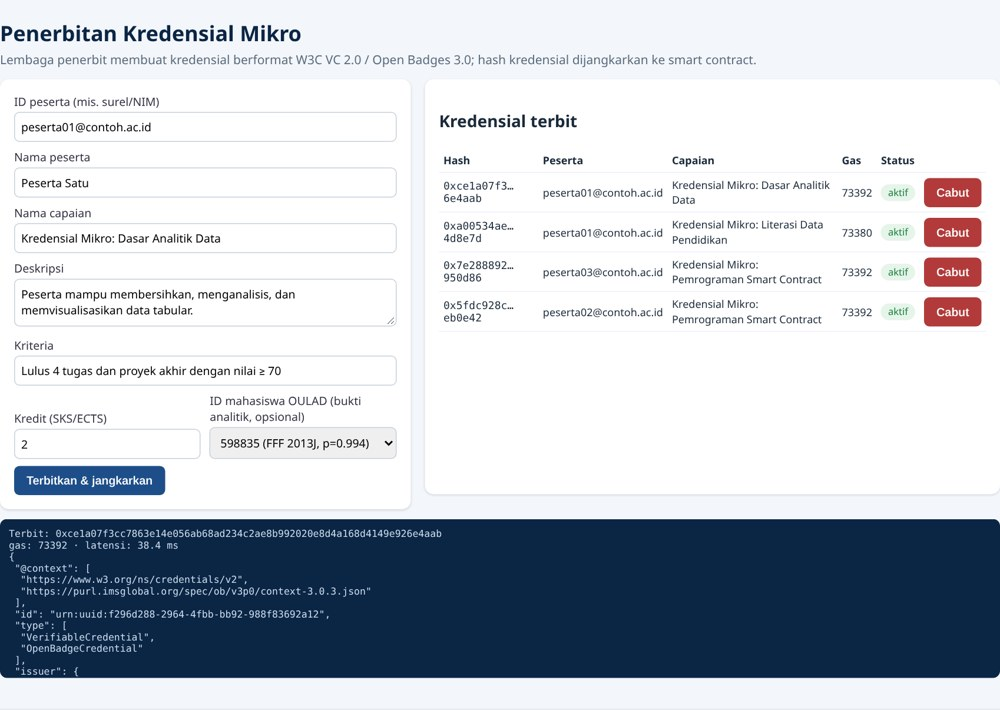<br>**Penerbit.** Formulir penerbitan kredensial mikro. | 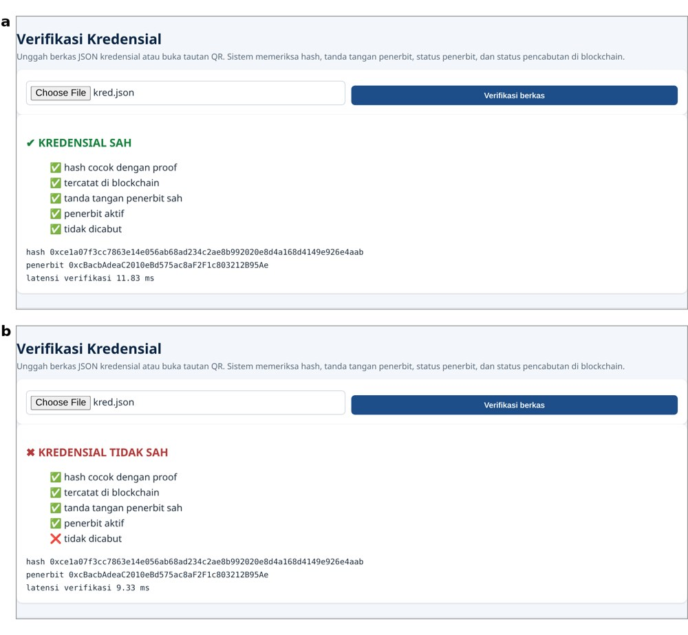<br>**Verifikasi.** Hasil verifikasi kredensial sah dan kredensial yang dicabut. |
| 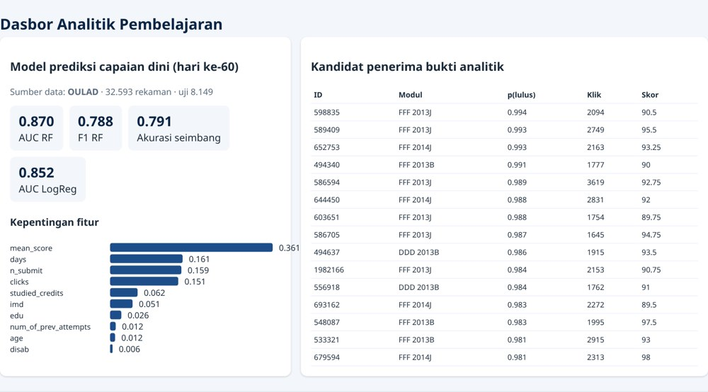<br>**Dasbor analitik.** Model prediksi capaian dini pada OULAD. | 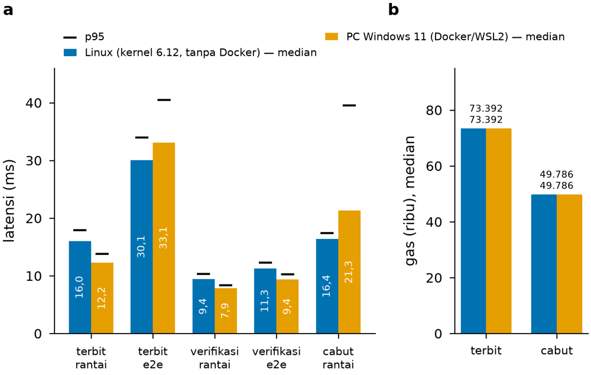<br>**Linux vs Windows.** Latensi penerbitan dan verifikasi pada dua lingkungan. |
| 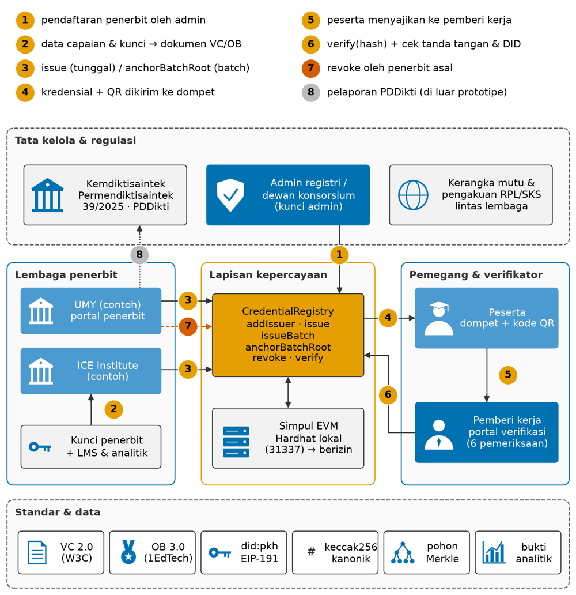<br>**Kerangka kerja menyeluruh** (Gambar 9.5 buku). | 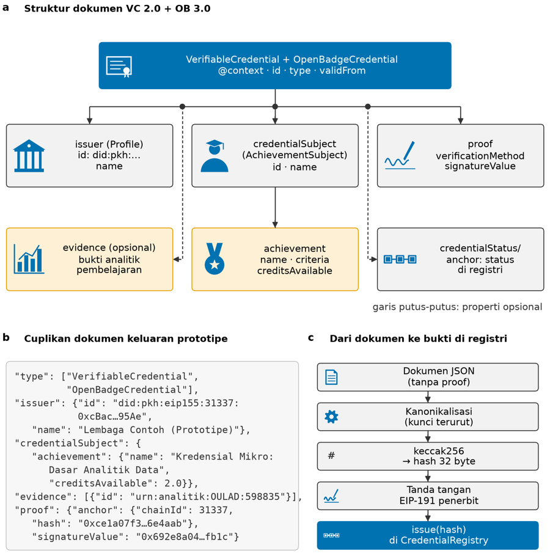<br>**Model data VC 2.0 + Open Badges 3.0** (Gambar 2.2 buku). |

## Galeri praktikum buku

Gambar berikut adalah keluaran asli praktikum dan eksperimen buku yang dihasilkan oleh kode di repositori ini (notebook `notebook/` dan skrip `experiments/`), diperkecil untuk README.

| | |
|---|---|
| 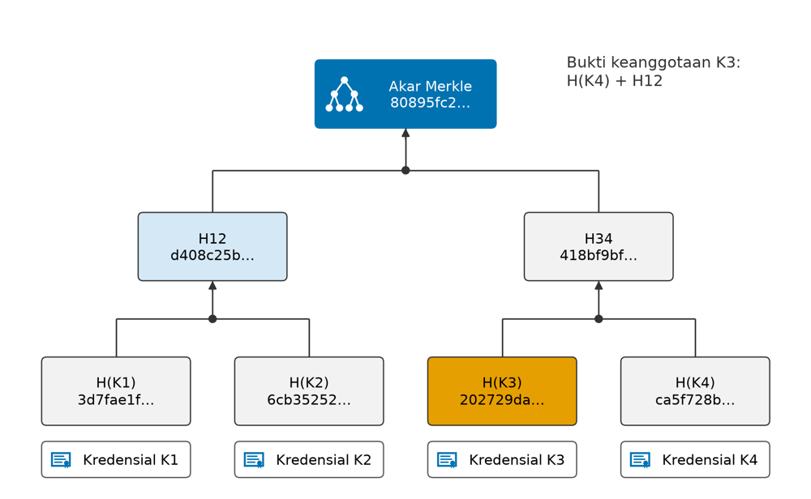<br>**Bab 3.** Pohon Merkle untuk penerbitan kredensial secara *batch* dan bukti keanggotaannya. | 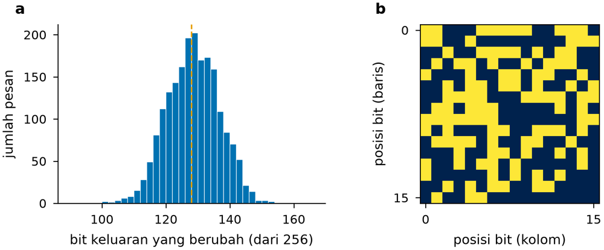<br>**Bab 3.** Efek *avalanche* keccak256: perubahan satu karakter mengubah sekitar separuh bit hash. |
| 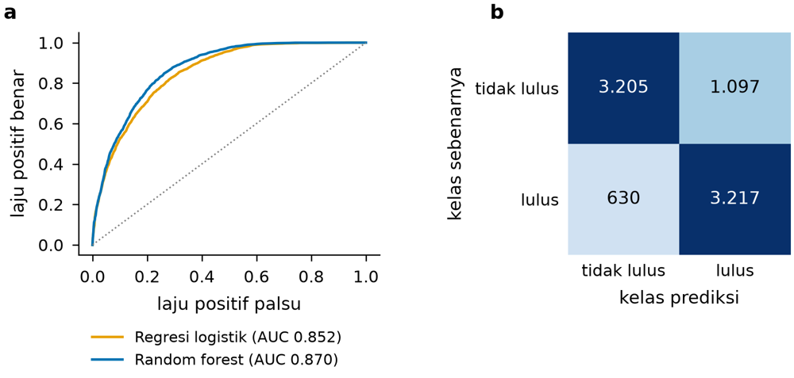<br>**Bab 5.** Kurva ROC model prediksi capaian dini pada dataset OULAD (CC BY 4.0). | 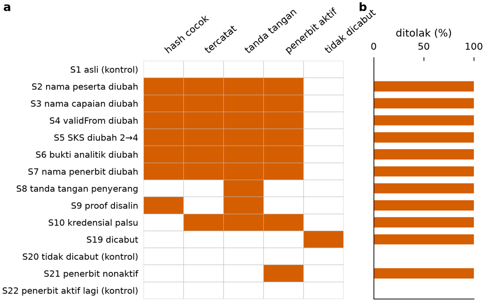<br>**Bab 8.** Matriks hasil uji skenario serangan terhadap prototipe. |
| 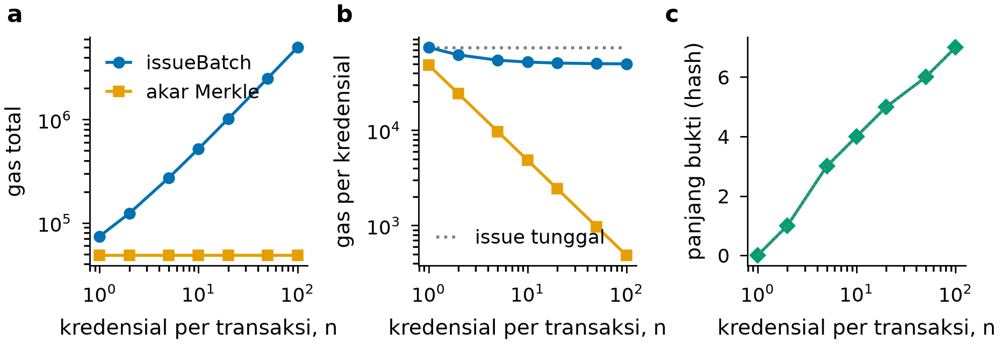<br>**Bab 10.** Biaya gas `issueBatch` dibandingkan dengan penjangkaran akar Merkle (total dan per kredensial) serta panjang bukti Merkle. | 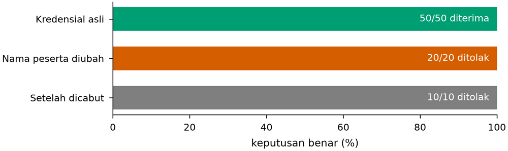<br>**Bab 10.** Deteksi kredensial asli, dipalsukan, dan dicabut pada uji ujung-ke-ujung. |
| 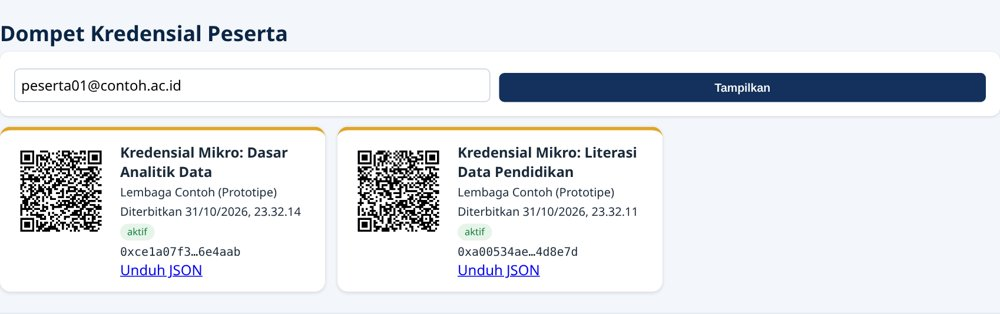<br>**Prototipe.** Dompet kredensial peserta (tangkapan layar asli). | |

## Dataset dan lisensi

Repositori ini **tidak** menyertakan dataset mentah. Berkas model `analytics/out/model.joblib` (±77 MB) juga tidak disertakan; jalankan `python analytics/train_oulad.py` untuk membuatnya ulang (aplikasi web tidak memerlukannya).

| Dataset | Dipakai untuk | Sumber | Lisensi |
|---|---|---|---|
| Open University Learning Analytics Dataset (OULAD) | Model prediksi capaian dini, bukti analitik kredensial | https://archive.ics.uci.edu/dataset/349 (Kuzilek dkk., 2017) | CC BY 4.0 |

Ekstrak semua CSV OULAD ke `analytics/data/oulad/`. Tanpa data, `python analytics/train_oulad.py --synthetic` menghasilkan **data sintetis** yang ditandai di dasbor.

Sitasi dataset: J. Kuzilek, M. Hlosta, dan Z. Zdrahal, "Open University Learning Analytics dataset," *Scientific Data*, vol. 4, 170171, 2017, doi:10.1038/sdata.2017.171.

## Keamanan

- Tidak ada kunci privat, frasa mnemonik, token, atau kata sandi di repositori ini.
- Saat pertama dijalankan, aplikasi membuat kunci penerbit **khusus pengembangan** secara acak di `data/`. Folder ini diabaikan git.
- Akun bawaan Hardhat node adalah **kunci uji lokal yang diketahui publik**. Kunci itu hanya boleh dipakai di jaringan lokal, **tidak pernah** di jaringan nyata.
- Kanonikalisasi JSON di prototipe disederhanakan (kunci terurut), dan tipe `proof` bersifat non-standar. Untuk produksi, gunakan Data Integrity atau JOSE sesuai W3C VC 2.0.

## Sitasi

IEEE:

> E. Prasetyo, Prayitno, S. S. Kusumawardani, dan H. Wijayanto, *Kredensial Mikro Terverifikasi Blockchain: Arsitektur Tepercaya Terintegrasi Analitik Pembelajaran untuk Pendidikan di Asia Tenggara* [kode sumber]. [Penerbit: PERLU DILENGKAPI], [tahun: PERLU DILENGKAPI], ISBN [PERLU DILENGKAPI]. https://github.com/kang-prayit/monograf-kredensial-blockchain

Bila memakai OULAD, sitasi juga makalah dataset di atas.

## Lisensi

Kode di repositori ini menggunakan lisensi **MIT** (lihat `LICENSE`), © 2026 Eko Prasetyo, Prayitno, Sri Suning Kusumawardani, dan Heri Wijayanto. Naskah buku tidak disertakan di repositori ini. Lisensi MIT tidak berlaku untuk dataset OULAD.
